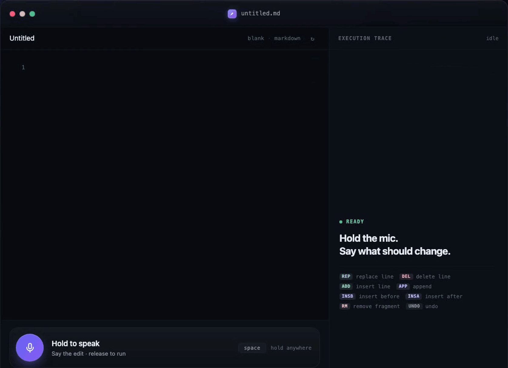

# Opline

A new way to create and update text using your voice.

This repository contains the code to run and interpret _opline_, a quantized fine-tuned 0.8B parameter model that understands natural language instructions to create and update markdown documents.

<p align="center">
  
</p>

**Example commands**:

- "Add heading saying todo list"
- "Add list item saying buying groceries"
- "Remove line five"
- "In line four replace walking down the hill with running up the mountain"

## How it works

The model receives the following input containing the system prompt, the user instruction and markdown document the change should be applied to:

```text
system: Convert the edit instruction into exactly one op line for the numbered document.

user:
In line four replace walking down the hill with running up the mountain

---

[L01] # Sunday
[L02] - Pack the bags
[L03] - Check the map
[L04] - Walk down the hill
```

The model output will be:

```text
REP [L04] walking down the hill || running up the mountain
```

The _executor_, a small deterministic TypeScript program, translates the model output into an actual file change. It finds the quoted anchor in the real document, applies the edit, and normalizes the markdown. Ambiguous or
unmatched ops are rejected whole, leaving the document untouched.

## Scope

Opline is a small, single-purpose edit model, not a general assistant.

- **Text in, text out.** It has no native audio support. It is trained on STT-style text (spoken
  phrasing, missing punctuation, spoken numbers); the demo transcribes speech with
  `nemotron-speech-streaming-en-0.6b` before calling it.
- **Mention the line number.** When changing an existing line, always mention its number: "Remove line
  five", "In line four replace walking down the hill with running up the mountain". The executor
  resolves the quoted anchor content-first, but every trained instruction that targets a line names it.
- **Phrasing matters.** The training data is fairly opinionated about phrasing: use the expected edit
  frame ("saying X", "replace X with Y", "continue with X"). Semantic targets such as "the second
  bullet" or "the paragraph about pricing" are not supported; quote the text instead.
- **Bare dictation continues the last paragraph.** "Buy milk" extends the paragraph ending the file;
  if the file ends in a list or heading, or is blank, it starts a new paragraph instead.
- **Edits, not authorship.** The instruction supplies the content: "Add a list item saying buy milk".
  Summarizing a paragraph, writing an ingredient list, or expanding notes into prose is left to
  whatever produces the dictation.
- **One line per turn.** Insert a line, delete a line, or edit one fragment inside a line. Requests
  like "rename every heading to title case" need one instruction per line.

## Model info

|              |                                                     |
| ------------ | --------------------------------------------------- |
| Base         | Qwen3.5-0.8B                                        |
| Size         | 0.87B parameters                                    |
| Quantization | Q4_K_M GGUF (517 MB)                                |
| Memory       | ~0.6 GB RAM/VRAM at 2k context (1k training window) |

## Quickstart

Requirements: Node 20+, the [`hf` CLI](https://huggingface.co/docs/huggingface_hub/guides/cli), and
[llama.cpp](https://github.com/ggml-org/llama.cpp) (`llama-server` on PATH):

```bash
brew install llama.cpp    # macOS; Linux: build from source or use a release binary
```

```bash
cd demo
npm install
cp config.example.json config.json

npm run model     # terminal 1: downloads the 4-bit GGUF (517 MB), serves :8080
npm run serve     # terminal 2: http://127.0.0.1:3000
```

`npm run model` uses `llama-server` from `PATH`. To use a specific binary, run
`LLAMA_SERVER=/path/to/llama-server npm run model`.

Type an instruction into the box under the document and press Enter.

### Voice (optional)

The page also has press-to-speak (hold Space or the mic button). It needs a local
[NeMo-Speech.cpp](https://github.com/NVIDIA/NeMo-Speech.cpp) server running
[`nvidia/nemotron-speech-streaming-en-0.6b`](https://huggingface.co/nvidia/nemotron-speech-streaming-en-0.6b)
(q8_0, ~600 MB), macOS only:

```bash
npm run stt:setup   # once: release binary + ~600 MB English GGUF
npm run stt:serve   # terminal 3: :10300
```

Without it the page falls back to typed instructions; the mic stays hidden.

## The ops

| Op                                            | Meaning                                          |
| --------------------------------------------- | ------------------------------------------------ |
| `ADD [Lnn] <text>`                            | insert a line before line `nn`                   |
| `APP <text>`                                  | append at end of file (also on a blank document) |
| `DEL [Lnn] <anchor>`                          | delete the resolved line                         |
| `RM [Lnn] <fragment>`                         | remove a fragment inside the line                |
| `REP [Lnn] <old> \|\| <new>`                  | replace a fragment                               |
| `INSB` / `INSA [Lnn] <anchor> \|\| <payload>` | insert before / after the anchor                 |
| `UNDO`                                        | undo the last change                             |

One op per turn, always. Anchors are verbatim fragments of the target line; the line number is a hint that the executor resolves content-first.

## License

Apache-2.0. The model weights are at
[`erknog/opline-0.8b`](https://huggingface.co/erknog/opline-0.8b), built on Qwen3.5-0.8B.
