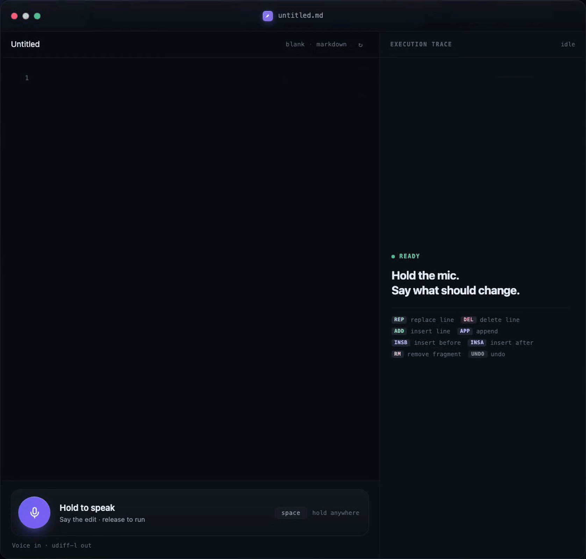

# Opline

Natural-language editing for Markdown. Say or type an instruction like *"remove the heading in
line five"*, a 0.8B model answers with exactly one edit op, and a deterministic executor applies it:

```text
"Remove the sub heading in line 11."   ->   DEL [L11] Questions and Answers
```

The model never regenerates the document. It emits a line-numbered, anchor-quoted op; the executor
resolves and applies it, so every character the instruction did not mention stays byte-identical.

<p align="center">
  
</p>

79 s of voice-driven edits with the execution trace on the right, encoded at 1676×1676 — the pixel size
GitHub actually paints at a typical desktop width on a 2× display, so the browser never upscales it.
GIF is the only animated format GitHub renders inline, and 256 colours are all it can hold, so the
frame rate carries the cost: 8 fps, 128 colours. The same recording is
[here as an MP4](docs/demo.mp4) (1080p, 30 fps, full colour — it plays in the file view).

## How it works

```text
browser  ──instruction + [Lnn] document──▶  demo server
                                               │
                                               ▼
                                     model server :8080
                                     (OpenAI-compatible)
                                               │  one op line
                                               ▼
                                          executor
                                    parse → resolve anchor → apply
                                               │
                                               ▼
                                      document (in memory)
```

- `executor/` — the op parser/applier and the edit session. No dependencies, no model.
- `demo/` — the showcase page plus a small Express server that proxies instructions to the model and
  streams microphone audio to a local speech-to-text server.

## Quickstart

Requirements: Node 20+, the [`hf` CLI](https://huggingface.co/docs/huggingface_hub/guides/cli), and
Python 3.10+ with `mlx-lm` on Apple silicon:

```bash
pip install mlx-lm        # or: uv tool install mlx-lm
```

```bash
cd demo
npm install
cp config.example.json config.json

npm run model     # terminal 1: downloads the 4-bit MLX model (424 MB), serves :8080
npm run serve     # terminal 2: http://127.0.0.1:3000
```

`npm run model` looks for `python3`/`python` with `mlx_lm` importable. If yours lives in a
virtualenv, pass it explicitly: `MLX_PYTHON=.venv/bin/python npm run model`.

Type an instruction into the box under the document and press Enter.

### Voice (optional)

The page also has press-to-speak (hold Space or the mic button). It needs a local
[NeMo-Speech.cpp](https://github.com/NVIDIA/NeMo-Speech.cpp) server, macOS only:

```bash
npm run stt:setup   # once: release binary + ~600 MB English GGUF
npm run stt:serve   # terminal 3: :10300
```

Without it the page falls back to typed instructions; the mic stays hidden.

### Another model backend

`config.json` points at any OpenAI-compatible `/v1` endpoint:

```json
{ "baseUrl": "http://127.0.0.1:8080/v1", "model": "default_model" }
```

That works for llama.cpp, vLLM, or the full-precision export of
[`erknog/opline-0.8b`](https://huggingface.co/erknog/opline-0.8b). Two rules from training apply to
whichever server you use: the system prompt is
`Convert the edit instruction into exactly one op line for the numbered document.`, and thinking must
be disabled (`enable_thinking: false`) or the op lands in the reasoning channel.

## The ops

| Op | Meaning |
| --- | --- |
| `ADD [Lnn] <text>` | insert a line before line `nn` |
| `APP <text>` | append at end of file (also on a blank document) |
| `DEL [Lnn] <anchor>` | delete the resolved line |
| `RM [Lnn] <fragment>` | remove a fragment inside the line |
| `REP [Lnn] <old> \|\| <new>` | replace a fragment |
| `INSB` / `INSA [Lnn] <anchor> \|\| <payload>` | insert before / after the anchor |
| `UNDO` | undo the last change |

One op per turn, always. Anchors are verbatim fragments of the target line (at most 12 words, unique
in the document); the line number is a hint that the executor resolves content-first.

## Checks

```bash
cd demo
npm run check       # executor selfcheck: parser, applier, anchors, undo — no network
npm run typecheck
```

## Layout

```text
executor/src/   executor.ts  prompt.ts  session.ts  client.ts  selfcheck.ts
demo/src/       server.ts
demo/public/    index.html  stt.js
demo/stt/       setup-local.sh  serve-local.sh
docs/           demo.gif  demo.mp4
```

## License

Apache-2.0. The model weights are at
[`erknog/opline-0.8b`](https://huggingface.co/erknog/opline-0.8b), built on Qwen3.5-0.8B.
